# diagram-axi

Turn a compact boxes-and-arrows text description into an editable diagram file plus PNG/SVG renders, with three engines behind one CLI: Excalidraw (default, editable and hand-drawn), D2 and Mermaid. Built for AI agents ([AXI](https://axi.md) spec `axi/1.0-2026-07`): terse TOON output, no prompts, exit codes 0/1/2, a `help[]` of next steps after every result.

Fully local and no account needed: layout, scene building, the D2 compiler (WASM) and the bundled Mermaid never touch the network. PNG/SVG rendering uses a Chrome, Edge, Chromium or Firefox you already have (nothing is downloaded). The one network use is the CJK font, fetched on demand from a sha-verified mirror only when a scene contains CJK text; `--fonts-url none` disables it.

## Why diagram-axi

### Fewer tokens than writing diagram files directly

An agent that draws through a plain CLI or an MCP server has to write the drawing format itself: every element of an `.excalidraw` scene with its coordinates, sizes, bindings and ids. diagram-axi lets it write only the graph (`.exd`); layout, routing and scene building happen in the tool. Measured on the same diagram (7 nodes, 7 arrows, 1 group; `test/fixtures/arch.exd`), tokens estimated as chars / 4:

| What the agent has to write or read | chars | ~tokens | vs `.exd` |
|---|---|---|---|
| `.exd` source (diagram-axi) | 276 | 69 | 1x |
| `.exd` + the `syntax example` slice it reads first | 843 | 211 | 3x |
| the `.excalidraw` scene for an Excalidraw CLI renderer (31 elements, minified) | 18,839 | 4,710 | 68x |
| the same diagram as Excalidraw MCP elements | 3,699 | 925 | 13x |
| MCP elements + the MCP cheat sheet the agent reads first | 30,642 | 7,661 | 111x |

Reproduce: `node scripts/token-compare.mjs` prints every row (it builds the scene with `draw`, no browser). `test/token.test.ts` keeps three ratios in place: the DSL under 1/20 of the scene, the DSL under 1/5 of the MCP JSON, and DSL + slice under 1/4 of MCP + cheat sheet.

The output side is short too, following [AXI](https://axi.md):
- **TOON summaries.** A `draw` answers in about six lines (outputs, scene counts, quality, `help[]`), not a log.
- **Errors carry the fix.** Each error gives `line:col` and a paste-able `suggestion`.
- **Reference in slices.** `syntax <topic>` slices are capped at 350 tokens, and the agent skill (`SKILL.md`) at 1,400.
- **One-line engine advice.** The `engine:` recommendation is a single line.

The agent spends its context on the diagram, not on the file format.

### Three engines that cover each other's weaknesses

No single renderer is good at everything. diagram-axi puts all three behind one DSL, measures where each fails, and routes the graph to the one that copes. The routing never switches silently; it prints `engine: suggest d2 (reason)`.

| Engine | Strong at | Weak at (measured) | Covered by |
|---|---|---|---|
| excalidraw | small, sparse, hand-editable boxes and arrows | hubs with more than 8 arrows, more than 2 arrows between one pair, long labels, more than 6 cross-group edges: stacked arrowheads, tangled routes | d2, via `engine: suggest d2` |
| d2 (ELK) | dense, nested and cross-linked groups, hubs, parallel edges, sequence/class/ER | hairballs (edges > 2 x nodes, 50+ nodes), tight multi-line edge labels | splitting the diagram; excalidraw when it must be hand-edited |
| mermaid | Markdown/GitHub inline rendering, state, timeline, git graph, mind map | nested groups, many cross-group edges, self-loops | d2 for those graphs; mermaid only for `--target markdown` and its own kinds |

The routing limits come from QA, not taste. Each engine was rendered on the same curated corpus plus held-out fuzz seeds, checked by a geometric checker, and reviewed visually by model reviewers. Accept rates on the gated cases, at each engine's final round:
- excalidraw 91.4%
- d2 97.9%
- mermaid 95.7%

The same QA shows the weak spots in the table. On multi-edge graphs vision accepted 2 of 4 excalidraw renders and 4 of 4 d2 renders. On nested groups mermaid's checker pass rate was 75-83%, against 99-100% for d2. `extract` uses the same routing for import graphs of real codebases.

## Install

```sh
npx -y diagram-axi            # zero install
npm i -g diagram-axi          # installs diagram-axi and the short alias dg-axi
```

Requires Node >= 20. No engine needs a separate install; see [Engines](#engines) for the optional d2 binary.

## Quick example

`order.exd`:

```
title "Order pipeline"
dir RIGHT
group edge "Edge" :blue {
  web[Web app]
  mobile[Mobile app]
}
api[API Gateway] :purple
web, mobile -> api : HTTPS
api -> auth{Auth?} : JWT
auth --> api : 401
api -> orders[Order svc] -> db[(Orders DB)]
api -.-> cache[(Redis)] : read-through
```

```sh
diagram-axi draw order.exd --png     # writes order.excalidraw and order.png
diagram-axi inspect order.excalidraw # node/edge/group counts, bounds, unresolved refs
```

Open the `.excalidraw` file at excalidraw.com to keep editing by hand.

Result (`order.png`):

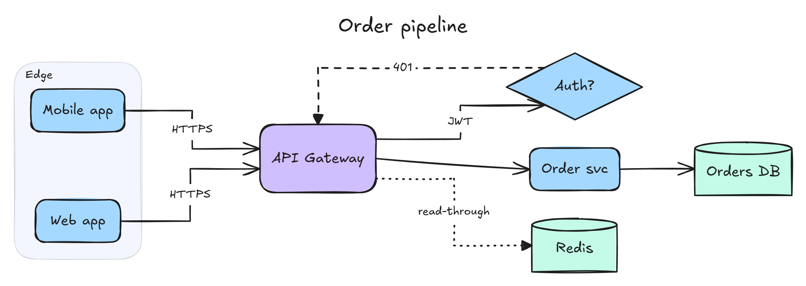

## Engines

One DSL (`.exd`) for boxes and arrows, three renderers, plus native `.d2` and `.mmd` sources for diagram kinds the DSL does not cover. `diagram-axi engines` shows status, versions and the PNG path of each engine.

| Engine | Best for | Source | Output | PNG via |
|---|---|---|---|---|
| `excalidraw` (default) | small, editable, hand-drawn boxes and arrows | `.exd` | `.excalidraw` (+ svg, png) | your browser |
| `d2` | dense or large graphs, sequence, class, ER/SQL tables | `.exd` or `.d2` | `.d2` + svg (always), png | your browser, or the optional d2 binary |
| `mermaid` | state, timeline, commit history, mind map; diagrams that render inline on GitHub or in Markdown | `.exd` or `.mmd` | `.mmd` + svg (always), png | your browser |

**Choosing.** The tool recommends and never switches silently. `--engine excalidraw|d2|mermaid` is explicit, `--engine auto` follows the recommendation, `--target markdown|github` forces mermaid, `--target editable` forces excalidraw. Without `--engine`, `check` and `draw` print at most one line:

- no `engine:` line: the graph fits the default engine (<= 25 nodes, edges <= 2 x nodes, no pair with more than 2 edges, <= 8 arrows per node, groups <= 2 deep, <= 6 cross-group edges, no label line over 40 chars);
- `engine: suggest d2 (large: 30 nodes); add --engine d2`: it outgrew excalidraw, with the first failing measure as the reason;
- `engine: d2 (native .d2)`, `engine: mermaid (target markdown)`: what was used and why.

Native files pick their engine from the extension and are never rewritten: `diagram-axi draw login.mmd --png` writes `login.svg` and `login.png` beside it. The diagram kind (sequence, class, erd, state, timeline, gitgraph, mindmap) comes from a `kind:` header comment, else the first keyword; `--kind` overrides. `--layout dagre|elk|tala` (d2) and `dagre|elk` (mermaid) pick the layout engine (elk by default); `--sketch` draws hand-drawn strokes. `diagram-axi syntax routing`, `syntax d2 [topic]` and `syntax mermaid [topic]` print the full rules in token-sized slices.

### Optional d2 binary

D2 renders in-process through the `@d2lang/d2` WASM package; SVG never needs anything else. PNG uses a Chrome, Edge, Chromium or Firefox you already have. To get PNG on a machine without a browser, download the pinned d2 v0.9.0 binary once:

```sh
diagram-axi engines install d2     # sha-verified download into the tool cache, then offline
diagram-axi engines                # shows d2-binary: ... when present
```

`--d2-path` or `DIAGRAM_AXI_D2_PATH` points at an existing binary instead; `DIAGRAM_AXI_CACHE_DIR` moves the cache. The binary is never vendored in the npm package. `--layout tala` also runs in the WASM package, so it needs no binary; see Licences below for its status.

### Licences

diagram-axi itself is MIT. D2 (`@d2lang/d2` and the optional binary) is MPL-2.0, used unmodified as a dependency or downloaded from the official release; its LICENSE and THIRD_PARTY_NOTICES ship in `node_modules/@d2lang/d2`. D2 SVGs embed Source Sans and Source Code Pro (SIL OFL). Mermaid and `@mermaid-js/layout-elk` are MIT; the bundled Mermaid page includes elkjs (EPL-2.0). `NOTICE` lists every component.

TALA (`--layout tala`) is offered as an option, not the default: elk is, and TALA is several times slower. The `LICENSE.txt` shipped with `@d2lang/d2` 0.1.34 and the one inside the d2 v0.9.0 release tarball are both MPL-2.0. Older D2 releases treated TALA as a separately licensed plugin, and this project has not independently verified the licence of every component inside the D2 binary or WASM, TALA included. If licence terms matter for your use, read D2's own LICENSE and THIRD_PARTY_NOTICES and prefer `--layout elk` or `dagre`.

## Examples

Each example in [`docs/examples/`](docs/examples) has its source and PNG/SVG renders, all produced by this tool. The `.exd` examples also keep the editable `.excalidraw` scene. Regenerate them with:

```sh
cd docs/examples
# excalidraw: .exd -> .excalidraw + png + svg
for f in *.exd; do diagram-axi draw "$f" --png --svg --scale 2 --force; done
# the order pipeline through the other two engines (rewrites order-pipeline-d2.d2 and -mermaid.mmd)
for e in d2 mermaid; do diagram-axi draw order-pipeline.exd --engine $e --out order-pipeline-$e --png --force; done
# native sources: .d2 / .mmd -> svg + png beside them (the sources are never rewritten)
for f in *.d2 *.mmd; do case "$f" in order-pipeline-*) continue;; esac; diagram-axi draw "$f" --png --force; done
```

### Sign-up flow (flowchart, `dir DOWN`)

```
title "Sign-up flow"
dir DOWN
start(Visitor)
form[Sign-up form]
valid{Email valid?}
err[Show error] :red
send[Send verify email] :yellow
done(Account active) :green
start -> form -> valid
valid --> err : no
err -> form
valid -> send : yes
send -> done : link clicked
```

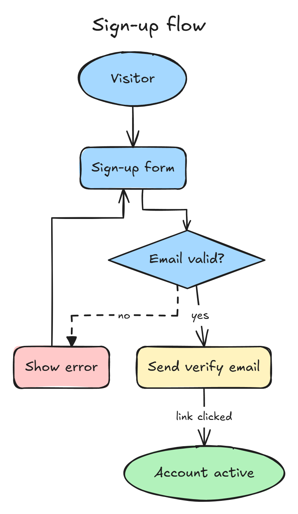

### RAG agent (group zone, cylinder, two-way edges)

```
title "RAG agent"
dir DOWN
user(User)
agent[Agent loop] :purple
group tools "Tools" :green {
  search[Web search]
  vdb[(Vector DB)]
}
user -> agent : question
agent -> search : query
agent -> vdb : embed + retrieve
search, vdb --> agent : context
agent -> user : answer
```

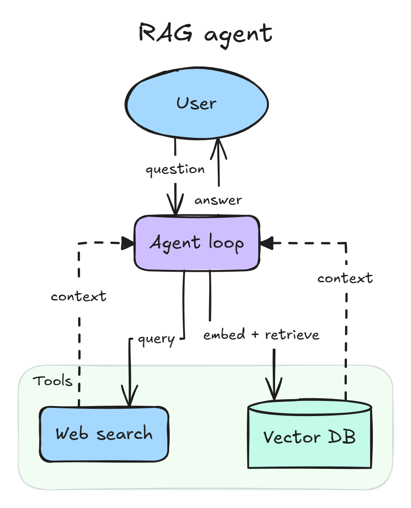

### One graph, three engines

The same `order-pipeline.exd`, drawn with `--engine d2` and `--engine mermaid` (the Excalidraw version is at the top):

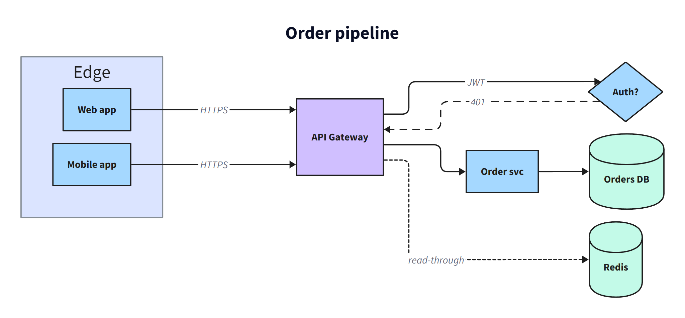
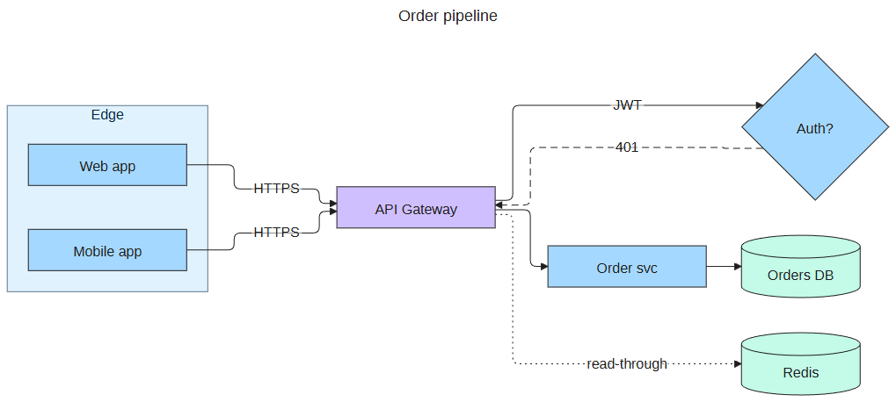

### Native sources

Kinds the DSL cannot express are written as native D2 or Mermaid. Sources: [`checkout-sequence.d2`](docs/examples/checkout-sequence.d2), [`orders-class.d2`](docs/examples/orders-class.d2), [`shop-erd.d2`](docs/examples/shop-erd.d2), [`login-state.mmd`](docs/examples/login-state.mmd), [`product-timeline.mmd`](docs/examples/product-timeline.mmd), [`release-flow.mmd`](docs/examples/release-flow.mmd), [`launch-mindmap.mmd`](docs/examples/launch-mindmap.mmd).

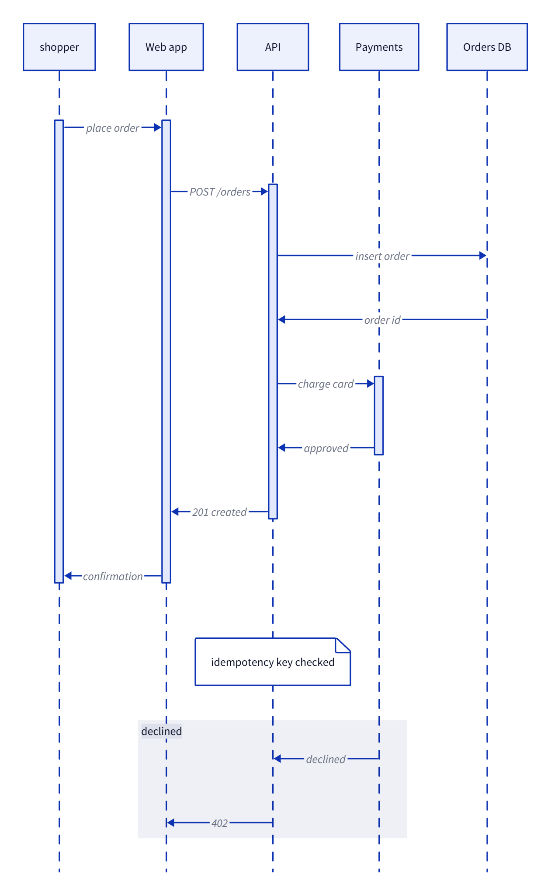 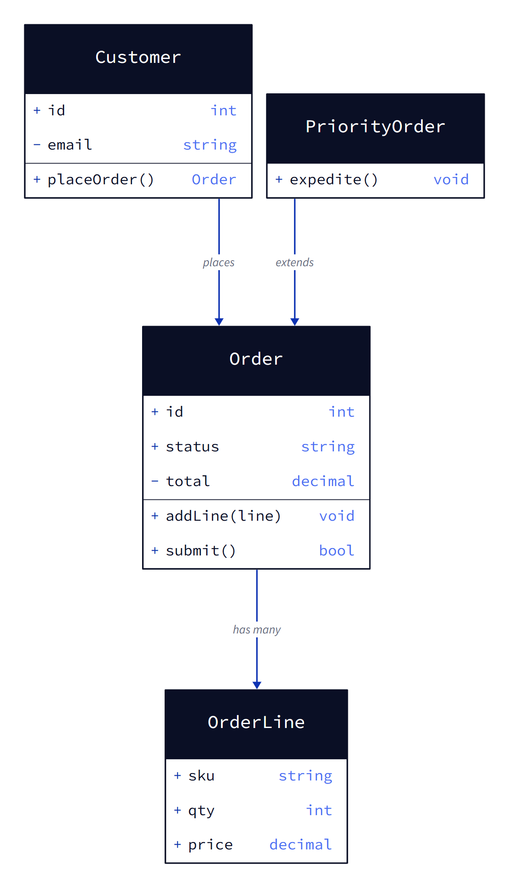

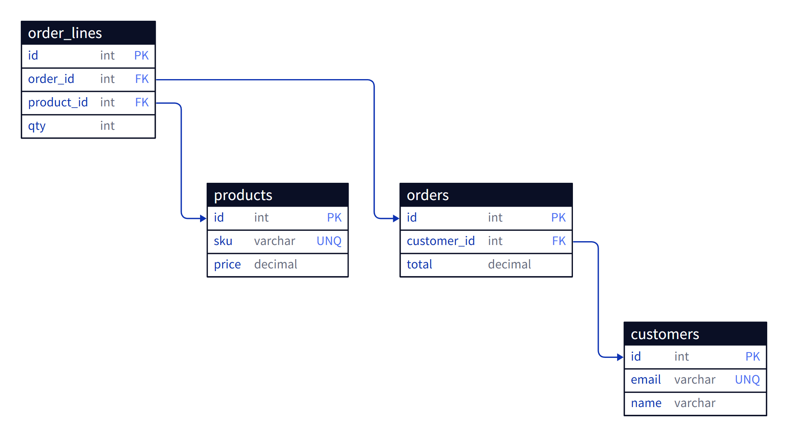

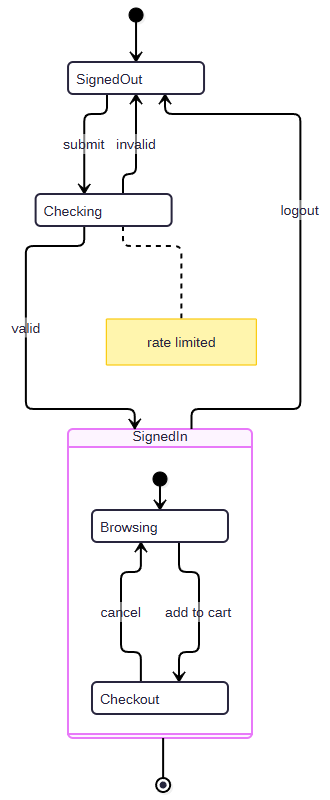 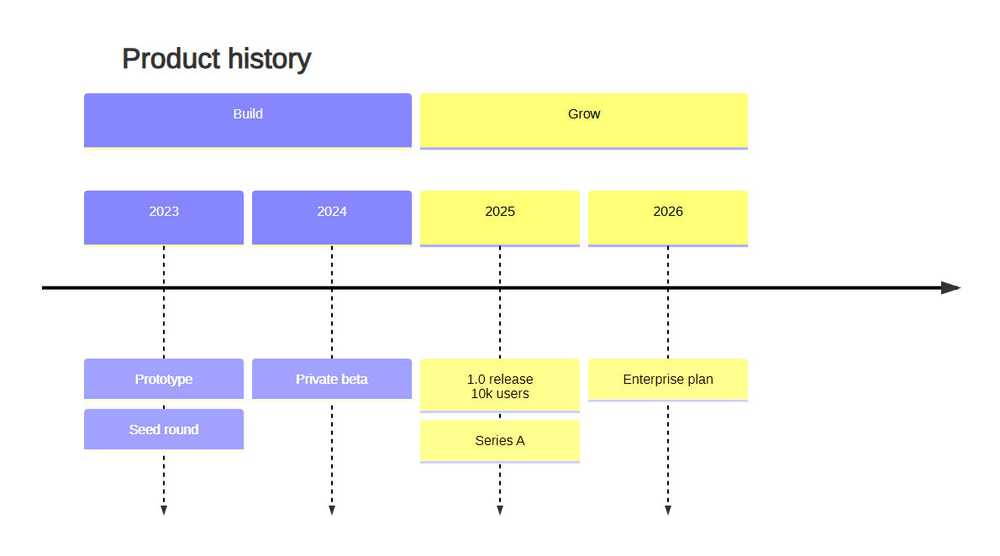

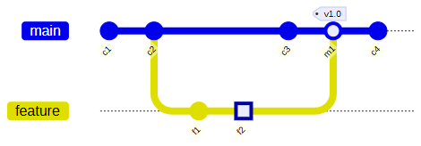 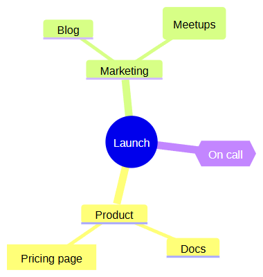

## DSL summary

| Syntax | Meaning |
|---|---|
| `id[Label]` `id(Label)` `id{Label}` `id[(Label)]` | rectangle, ellipse, diamond, cylinder; `\n` in a label breaks the line |
| `a -> b`, `a --> b`, `a -.-> b`, `a -- b`, `a <-> b` | solid, dashed, dotted, plain line, both heads |
| `a -> b : text` | edge label (rest of the line; quote it to keep a `#`) |
| `a -> b -> c`, `a, b -> c, d` | chains and fan-out (cross product) |
| `api[API] :purple,bold` | node style: a color, then flags (`dashed dotted bold sketchy`) |
| `group id "Title" :blue { ... }` | zone around its nodes; groups nest |
| `dir RIGHT`, `title "Text"` | direction (`DOWN UP LEFT`, aliases `TB TD BT LR RL`) and heading |
| `# comment`, `a -> b; b -> c` | comments; several statements on a line |

Colors: blue, green, orange, purple, red, yellow, teal, pink. Uncolored nodes are light blue; cylinders teal. Run `diagram-axi syntax` for token-sized reference slices (`nodes`, `edges`, `groups`, `style`, `example`).

## Commands

| Command | Purpose |
|---|---|
| (no args) | home: `.excalidraw` scenes under the current directory (newest 10, depth <= 4, element counts; -1 = unreadable), a DSL teaser, next steps |
| `draw <file\|->` | DSL (file or stdin), `.d2` or `.mmd` to a diagram file; `--png` / `--svg` also render (d2 and mermaid always write SVG); `--engine`, `--target`, `--kind`, `--layout`, `--sketch`, `--out`, `--direction`, `--force` |
| `render <scene>` | `.excalidraw`, `.d2` or `.mmd` to PNG/SVG; `--scale`, `--theme`, `--transparent`, `--padding`, `--browser-path`, `--fonts-url` |
| `inspect <scene\|dsl\|d2\|mmd>` | aggregates without rendering |
| `check <file>` | lint a DSL file with `line:col` (compile-check a `.d2`/`.mmd`); prints the `engine:` line; `--strict` makes warnings fail |
| `extract <dir>` | import graph of a TS/JS codebase to `imports.exd` (cut to `--max-nodes 25`, folders as groups) plus `imports.exd.map.json`; `--focus`, `--depth`, `--dir`, `--expand`, `--group`, `--include`, `--exclude`, `--externals`, `--types`, `--tests`, `--hubs`, `--tsconfig`, `--format json`, `--out`, `--force` |
| `syntax [topic]` | DSL reference slices; `syntax d2 [topic]`, `syntax mermaid [topic]`, `syntax routing`, `syntax extract` |
| `engines` | engine status and versions; `engines install d2` downloads the optional binary |

Every command answers `--help`. Browser lookup: `--browser-path`, then env `DIAGRAM_AXI_BROWSER_PATH`, then discovery. Chrome, Chromium and Edge run on a persistent profile from a small pool under the tool cache (`chrome-profiles/slot-N`, up to 4 at once; a launch waits for a free slot rather than paying a logon), so Chrome's Windows blank-password check (a failed OS logon, cached per profile) runs once per slot, not once per launch. `DIAGRAM_AXI_CHROME_PROFILE_DIR` moves the pool, `DIAGRAM_AXI_CHROME_PROFILE_SLOTS` sets the cap, `DIAGRAM_AXI_CHROME_PROFILE=temp` goes back to a fresh temp profile per launch.

Home (no args) lists `.excalidraw` scenes plus native `.d2` / `.mmd` files and an `engines:` status line.

## Learn a codebase

`extract` is **experimental**. On 28 views of 6 pinned public repos plus this one it is 28/28 clean by the layout checker; two vision reviewers accept 96.4% of the pictures (27/28 each) and every default view. The remaining weak spot is dense `--max-nodes 15` views drawn on excalidraw, where edge labels can sit inside bundles of parallel lanes (`docs/plans/2026-10-25-extract-hardening-plan.md`). Check the picture. `extract` reads the static imports of a TS/JS folder (oxc, offline, in-process) and writes a diagram source; it never draws. Draw the `.exd` it wrote, following the `engine:` line it prints (a real repo nearly always says `suggest d2`):

```sh
diagram-axi extract src                              # imports.exd + imports.exd.map.json, TOON summary
diagram-axi draw imports.exd --engine d2 --png       # folders are groups, busy files are yellow, cycles red
diagram-axi extract src --focus src/cli/router.ts    # zoom: that file and its imports/importers, 2 hops
diagram-axi extract src --expand src/commands --group none   # open a folder; flat path labels
```

What the picture shows. Dense or wide views are routed to d2 (`engine: suggest d2`): more than 1.5 arrows per box from 12 boxes, 7 arrows into one box, or a layer wider than 7 boxes; a flat sparse view stays on excalidraw. The entry (package `bin`/`main`/`module`/`exports`, a build output such as `dist/index.js` mapped back to its source, else the root index) and the `--focus` file are green; a collapsed folder that contains it says `entry: node.ts` (or `focus: <file>`). Hubs are yellow with one note line, `used by 20, 2 uses hidden`: their incoming arrows are not drawn (the sidecar lists them as `hubEdges`) and `K uses hidden` means only the heaviest outgoing arrows are. In a `--focus` view, `... +k more` stubs stand for unreached neighbours and are joined to their file by a plain line, not an arrow.

Large graphs are cut to the node budget (big folders collapse to `layout/ (17 files)`), and the output counts everything hidden (externals, tests, type-only imports, hub edges) and lists unresolved imports. The sidecar `imports.exd.map.json` maps each box id to its files and import lines, so an agent can go from a box to the source. `--format json` writes the full scan graph instead. Output is deterministic: two runs give identical files. Exit codes: `0` ok, `1` extraction failure or refused overwrite, `2` usage error (bad flag or value, `--focus` outside `<dir>`).

## Exit codes

`0` success or no-op, `1` error (parse error, missing browser, refused overwrite), `2` usage error (unknown flag, command or topic; the message lists the valid ones). Output is TOON on stdout; stderr stays silent on success.

## For agents

**Give an agent the skill.** The skill is one folder, `skills/diagram-axi/` (it ships in the npm package too). For Claude Code, copy it to `~/.claude/skills/diagram-axi/` (every project) or `<project>/.claude/skills/diagram-axi/` (one project); other agents that read `SKILL.md` files take the same folder.

```sh
# from a checkout of this repo
mkdir -p ~/.claude/skills && cp -r skills/diagram-axi ~/.claude/skills/
# or from a global npm install
cp -r "$(npm root -g)/diagram-axi/skills/diagram-axi" ~/.claude/skills/
```

The skill runs every command as `npx -y diagram-axi ...`, so the agent's machine needs Node >= 20.19. PNG/SVG need an installed Chrome, Edge, Chromium or Firefox; without one, `draw` still writes the editable `.excalidraw`. Until the package is on npm, build from a checkout (`npm ci && npm run build && npm link`) so `diagram-axi` is on the PATH, and tell the agent to run `diagram-axi` instead of `npx -y diagram-axi`.

`skills/diagram-axi/SKILL.md` is generated from `src/skill/content.ts` (`npm run skill:gen`; `npm run skill:check` fails when stale). It carries the golden path (`syntax example`, write a `.exd`, `check`, `draw x.exd --png`, `inspect`) and the engine choice table, in under 1,400 tokens.

## Develop

```sh
npm install && npm test           # pretest builds
npx -y axi-axi validate "node bin/diagram-axi.js" --dir .
```

## Credits

The headless-browser renderer design, font handling and browser discovery follow [excalidraw/cli](https://github.com/excalidraw/cli) (MIT). The color palette and element conventions follow the [excalidraw-mcp](https://github.com/excalidraw/excalidraw-mcp) cheat sheet (MIT). See `NOTICE`. MIT licensed.
